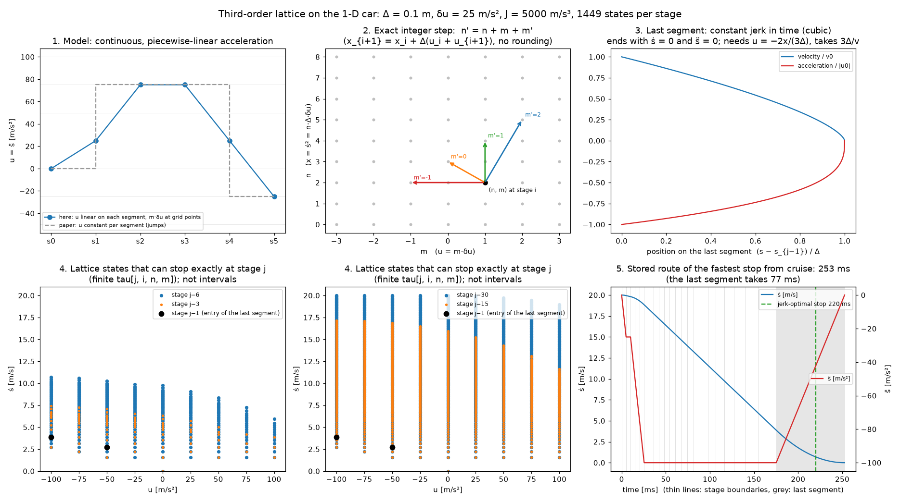

# Time-optimal safe path tracking (reproduction)

A from-scratch reproduction of
S. Fujii and Q.-C. Pham, *Time-Optimal Path Tracking with ISO Safety Guarantees*, IROS 2023
([arXiv:2306.05197](https://arxiv.org/abs/2306.05197)).

The robot tracks a fixed path as fast as its joint limits allow, but chooses each control
so that it can always be at rest before any obstacle (moving at most `v_max`) can reach it.
If a collision happens, the robot is stationary (ISO/TS 15066 speed and separation monitoring).

## Setup

```sh
uv sync
./scripts/fetch_assets.sh      # UR5e model from MuJoCo Menagerie (only for the robot experiment)
uv run pytest
```

Torch comes from the CUDA 12.8 wheel index (needed for Blackwell GPUs). Every torch function
also runs with `device="cpu"`.

## Layout

| file | content |
|---|---|
| `src/tospt/constraints.py` | per-stage `a u + b x <= c` from toppra joint velocity/acceleration constraints |
| `src/tospt/lp2d.py` | one-step sets `Q_i` (2-variable LP) |
| `src/tospt/stoppable_sets.py` | stoppable sets `K[j, i]` |
| `src/tospt/lp1d.py` | branch-free 1-D LP (paper Sec. III-C) |
| `src/tospt/time_to_reach.py` | Time-to-Reach `tau[j, i, k]` and next index `rho` (Alg. 1); serial and torch |
| `src/tospt/controller.py` | Time-to-Arrive (Eq. 6), stop-stage selection (Eq. 7), greedy step, path follower |
| `src/tospt/jerk_filter.py` | joint jerk limits (extension, not in the paper): stage rows and moving-average follower |
| `src/tospt/third_order.py` | prototype with the acceleration as a state (1-D car only) |
| `src/tospt/mujoco_scene.py` | UR5e scene, distances to its collision capsules |
| `experiments/car_1d.py`, `zanchettin.py` | Exp. 1: 1-D car vs. Zanchettin-style controller |
| `experiments/bench_precompute.py` | Exp. 2: serial vs. GPU pre-computation |
| `experiments/robot_6dof.py` | Exp. 3: UR5e in MuJoCo with 1 or 6 obstacles at 1.6 m/s |

## Running the experiments

```sh
uv run python experiments/car_1d.py                     # -> results/car_1d.png
uv run python experiments/car_1d.py --sweep-stopping-time
uv run python experiments/bench_precompute.py           # -> results/bench_precompute.png (~2 min)
uv run python experiments/robot_6dof.py --obstacles 1   # add --viewer to watch in MuJoCo
uv run python experiments/robot_6dof.py --obstacles 6
uv run python experiments/robot_6dof.py --precompute-trials 20
uv run python experiments/car_1d.py --jerk-limit 5000 --out results/car_1d_jerk.png
uv run python experiments/robot_6dof.py --obstacles 1 --jerk-limit 1000
uv run python experiments/car_1d_jerk.py                 # smoothed plan vs. third-order prototype
uv run python experiments/third_order_figure.py          # -> docs/third_order_lattice.png
```

## Results

Hardware: NVIDIA RTX 5080 Laptop GPU. The paper used a GTX 1080 Ti (Exp. 2) and an RTX 2060 Max-Q (Exp. 3).

### Exp. 1: 1-D car (goal 25 m, 20 m/s, 100 m/s², wall 20 m/s, `d_protective = 0`)

| | paper | reproduced |
|---|---|---|
| ours stops at contact with max deceleration | yes | yes (speed 0 while touching) |
| ours reaches the goal first | yes | 2.82 s vs. 3.58 s (`T_s = 0.55 s`) |
| smallest feasible stopping time `T_s` of the baseline | 0.55 s | 0.40 s (= `(v_max + v_wall) / a_max`) |
| bang-bang spikes when following the wall | yes | yes |

### Exp. 2: Time-to-Reach computation (random 6-DoF paths, 10 trials)

| setting | serial | torch CUDA float64 |
|---|---|---|
| N = 300, M = 50 | 1.01 s | 0.052 s |
| N = 500, M = 50 | 2.16 s | 0.142 s |

The paper reports 0.25 s for N = 500, M = 30 on the GPU, and at least 1 s for serial.

### Exp. 3: UR5e, N = 513 stages, ±20 rad/s², ±π rad/s, 20 s runs, control period 4 ms

| | paper | reproduced |
|---|---|---|
| total pre-computation, 20 paths, serial | 4.03 ± 1.01 s | 4.93 ± 1.23 s |
| total pre-computation, 20 paths, GPU | 0.40 ± 0.09 s | 0.21 ± 0.01 s |
| stoppable sets | 0.20 ± 0.04 s (16 processes) | 0.12 s (1 process) |
| execution phase per cycle | within 6 ms | max 3.9–6.3 ms, mean 0.9–1.6 ms (with obstacles) |
| joint speed whenever distance <= 0 | 0 | 0 (all runs) |

| obstacles | M | legs done in 20 s | cycles in contact | emergency decisions |
|---|---|---|---|---|
| 0 | 30 | 31 (= exact TOPP-RA time, 0.64 s per leg) | 0 | 0 |
| 1 | 30 | 24 | 135 | 0 |
| 1 | 100 | 24 | 130 | 0 |
| 6 | 30 | 12 | 730 | 0 |
| 6 | 100 | 12 | 792 | 0 |

An "emergency decision" means that no stopping route passes the Eq. 7 check and no previously checked stop is still valid.
The robot then brakes to the nearest stage where it can stop, and this fallback is not checked against ψ.
In 4 more seeds with 6 obstacles and M = 30 and 100, the count was also 0.
For the cause of earlier emergencies, see [Timing of decisions](#timing-of-decisions).

### Timing of decisions

Each control decision holds for one path segment, so decisions happen at stage boundaries *inside* a control cycle.
Time-to-Arrive ψ is computed from the obstacle positions at the start of the cycle.
So a decision taken `e` seconds into the cycle uses `ψ − e` (`CycleDecider` in `src/tospt/controller.py`).

An earlier version subtracted a fixed latency of one full cycle instead.
That is safe for one decision, but inconsistent between decisions:
- between two decisions in consecutive cycles, ψ is charged a full cycle of obstacle motion;
- the robot, however, may have moved for less than one cycle.

A stop that was checked at one decision could then fail at the next one by a fraction of a millisecond, while the robot
was braking toward that stop. This produced all the emergency decisions seen before: 1 run with 1 obstacle, 38 and 27 with 6 obstacles.
I first thought that most of them came from the floor quantization of the grid routes, but fixing the timing alone removed all of them.

As a second safeguard, if the grid check finds no safe stop, the controller keeps the last stop that passed the check,
as long as the state is still inside its stoppable set. This stays safe, because two things hold:
- **The robot is never slower than the checked route.** It follows the greedy pass inside that set, which starts at least
  as fast as the grid route and takes the largest admissible step at every stage.
  This assumes that a faster state never leads to a slower next state, which holds when the stages are short.
- **Robot and obstacle times advance together.** Both arrival times and ψ decrease by the same elapsed time.

With the timing fix, this safeguard did not trigger in any run. It is covered by a unit test.

## Fast stoppable sets

The stoppable sets `K[j, i]` need one one-step set `Q_i(K[j, i+1])` for every pair `j > i`, which is O(N²) small LPs.
For N = 500 on the UR5e path, they now take 0.12 s on one CPU process. My first version took 6.4 s, so this is about 50x faster.
For reference, the paper reports 0.20 s with 16 processes, on different hardware.
Three changes give the speed-up (`src/tospt/stoppable_sets.py`, `src/tospt/lp2d.py`):

1. **Sweep over `i` once, vectorized over `j`.** `K[j, i]` depends only on `K[j, i+1]`. So instead of one backward pass per `j`,
   a single loop runs over `i = N-1 … 0` and computes `K[:, i]` for all `j > i` in one numpy batch.
   Only N sequential steps remain.

2. **Solve each distinct target interval once.** Far from `j`, the sets stop changing, so many `j` share the same `K[j, i+1]`.
   `np.unique` finds the distinct intervals, and the results are copied back to all `j`.

3. **Reuse the stage polygon, and solve only on two lines (the main gain).**
   `Q_i([lo, hi])` is the x-range of the convex polygon `Ω_i = {(u, x) | a u + b x <= c, 0 <= x <= x_max}` cut by the strip
   `lo <= x + 2Δ u <= hi`. The minimum and maximum of x lie at a vertex of this cut polygon. Each such vertex is either
   - a vertex of `Ω_i` that lies inside the strip, or
   - a point on one of the two strip lines `x + 2Δ u = lo` or `x + 2Δ u = hi`.

   `Ω_i` does not depend on `j`. So its vertices are computed once per stage, and for each interval we only test whether they lie in the strip.
   On a strip line, substitute `u = (h − x) / (2Δ)`. Every row then becomes a bound on x alone, so the x-range on the line is a 1-D LP.
   It is solved with the same branch-free min/max solver as the Time-to-Reach step.

   Before this change, the code enumerated vertices of the full cut polygon for every interval: all row pairs (O(R²))
   with an O(R) feasibility check each, so O(R³) per interval (R ≈ 28 rows for 6 joints). Now each interval costs
   O(R) for the two lines plus O(V) for the vertex test (V = number of vertices of `Ω_i`).

`tests/test_stoppable_sets.py` checks the result against `scipy.optimize.linprog`, the closed-form braking distance of the 1-D car,
and the nesting property of Theorem 1.

## Jerk limits

This is an extension. The paper has no jerk limit: `u = s̈` is constant on each segment, so the acceleration
jumps at every stage boundary and at every stop.

### Why not inside the planner

The joint jerk along the path is

```
q⃛ = q'(s) s⃛  +  3 q''(s) ṡ s̈  +  q'''(s) ṡ³
```

A bound on `s⃛` makes the acceleration a state. Then the method loses its structure:
- the stoppable sets become 2-D sets in `(x, u)` instead of intervals;
- in the s-domain `s⃛ = u'(s) √x`, so the constraint is not convex in `x`;
- a stop with zero acceleration is singular in `s` (`u ∝ (s_end − s)^(1/3)`).

### What is implemented

The planner stays second-order. The robot executes the moving average of the planned position
(`SmoothedFollower` in `src/tospt/jerk_filter.py`):

```
s(t) = mean of s_ref over [t − T, t]
```

Because the filter acts on the scalar `s`, three things hold exactly:
- the robot stays on the path, and `s_ref(t − T) <= s(t) <= s_ref(t)`;
- when the plan stops at stage `j`, the robot stops at the same stage, at most `T` later;
- `s⃛(t) = (s̈_ref(t) − s̈_ref(t − T)) / T`, so `|s⃛| <= (u_max − u_min) / T`.

**Safety.** The robot passes every stage at most `T` after the plan. So the plan is checked with `ψ − T`
(the `latency` argument of `time_to_arrive`). Eq. 7 then gives `arrival + T < ψ` for the real robot.

**Jerk budget per joint.**
1. The terms without `s⃛` become linear stage rows: `√xmax_i · |3 q'' u + q''' x| <= G`.
   `√x` is replaced by its stage maximum to keep the rows linear. This is only loose at low speed,
   where these terms are small anyway. `G` is at most `geometric_share · J` (default 0.25),
   and it is 0 on a straight path.
2. The window bounds the first term: `T = max over stages and joints of |q'| · swing / (J − G)`,
   where `swing` is the widest interval of admissible `u` at one stage and one velocity.
   For the car this is `T = 2 a_max / J`, the time to swing from full acceleration to full braking.

### Results

1-D car (same setting as Exp. 1), `a_max = 100 m/s²`:

| jerk limit [m/s³] | window T | arrival | max jerk / limit | speed while touching |
|---|---|---|---|---|
| none | - | 2.82 s | - | 0 |
| 20000 | 10 ms | 2.85 s | 1.00 | 0 |
| 5000 | 40 ms | 2.94 s | 1.00 | 0 |
| 2000 | 100 ms | 3.13 s | 1.00 | 0 |

UR5e (same setting as Exp. 3, M = 30, seed 0, `geometric_share = 0.25`). Derivatives are finite differences of
the executed joint positions at 4 ms.

| jerk limit [rad/s³] | window T | legs, 0 obs. | legs, 1 obs. | legs, 6 obs. | max jerk / limit | max acc. / limit | emergencies |
|---|---|---|---|---|---|---|---|
| none | - | 31 | 24 | 12 | - | 1.00 | 0 |
| 2000 | 24 ms | 30 | 21 | 8 | 0.83 | 1.00 | 0 |
| 1000 | 56 ms | 28 | 17 | 4 | 0.74 | 0.98 | 0 |
| 500 | 60 ms | 23 | 10 | 1 | 0.71 | 0.70 | 0 |

The joint speed is 0 in every cycle with contact, in all runs.

### Limits

- **Stops are later than necessary.** The delay is `T = 2a/J`. A jerk-optimal stop needs `2a/J` from full
  acceleration, but only `a/J` from cruise. With many obstacles this latency costs much of the productivity (table above).
- **The split is a trade-off.** A small `geometric_share` gives a short window but slows the free motion
  (at 500 rad/s³: share 0.25 gives 23 legs with 60 ms, share 0.5 gives 25 legs with 160 ms).
- **Limits hold up to an error of order T.** The filter averages plan states over a short piece of the path,
  while the rows and the swing are taken per stage. In a test on random 5-waypoint paths, joint velocity and
  acceleration exceeded their limits by 1–3 % for windows of 50–160 ms. The experiments print the measured ratios.
- **Rows hold at grid points only**, like all other constraints here (collocation).
- A third-order version with the acceleration as a state should remove the first two limits. The prototype below
  shows that this is not easy on a grid in `s`.

### Third-order prototype (1-D car only)

`src/tospt/third_order.py` makes the acceleration a state, for a straight path with uniform stages.

- `u = s̈` is continuous and linear in `s` on each segment. At grid points it takes values `m · δu`.
- Then `x_{i+1} = x_i + Δ (u_i + u_{i+1})`, so `x` stays on the lattice `n · Δ · δu`.
  The state is the integer pair `(n, m)`, and the next state is `n' = n + m + m'`. Nothing is rounded.
- On a segment the jerk is `u'(s) · ṡ`, largest where `ṡ` is largest, so every constraint is a plain inequality (no LP).
- Rest is an equilibrium of these segments (reached only in infinite time). So the segment into a stop and the
  segment out of rest use constant jerk in time. This needs `u = ∓ 2x / (3Δ)` at the moving end.
- `tau[j, i, n, m]` is an exact DP over the lattice. The controller follows the stored route exactly, so a route
  that passed the Eq. 7 check stays safe without further assumptions.
- `δu <= J Δ / v_max` is required, so that the acceleration can change by one level per stage at top speed.



The figure is made by `experiments/third_order_figure.py` from the real tables (250 stages, 5000 m/s³).

1. **Model.** The acceleration is continuous and linear on each segment (blue). The paper's model has jumps (dashed).
2. **Integer step.** From `(n, m)`, each choice of the next level `m'` leads to the lattice state `n' = n + m + m'`.
3. **Last segment.** Velocity and acceleration reach 0 together at the stop stage.
4. **Stoppable states.** Lattice states with finite `tau[j, i, ·, ·]`, for three stages `i` before the stop stage `j`.
   They grow backward from the entry states of the last segment (black). They are sets of points, not intervals.
5. **Fastest stop from cruise.** The stored route in time. The grey band is the last segment,
   the dashed line is the jerk-optimal stop time.

Comparison on the car (`experiments/car_1d_jerk.py`, 250 stages, CPU). The jerk-optimal stop from cruise takes `v/a + a/J`.

| jerk limit | method | tables | pre-computation | arrival, no wall | arrival, wall | stop from cruise (optimal) |
|---|---|---|---|---|---|---|
| 5000 m/s³ | smoothed plan | 103 MB | 0.9 s | 1.489 s | 2.94 s | 241 ms (220) |
| 5000 m/s³ | third-order | 456 MB | 1.3 s | 1.524 s | 3.04 s | 253 ms (220) |
| 5000 m/s³ | third-order, 2x levels | 1719 MB | 18 s | 1.524 s | 3.04 s | 253 ms (220) |

With 150 stages and 2000 m/s³: smoothed plan 301 ms, third-order 316 ms (282 ms with 2x levels, 824 MB), optimal 250 ms.
Both methods keep jerk, acceleration and velocity within the limits, and the car is at rest whenever the wall touches it.

Findings:
- **The prototype is not faster than the smoothed plan.** The loss is in the segments into and out of rest
  (see [Why it is slower](#why-it-is-slower-than-the-smoothed-plan)).
- **Very few states can enter the last segment.** Only even negative levels with `n = 1.5 |m|` qualify. In the figure
  these are 2 of 1449 states: (3.87 m/s, −100 m/s²) and (2.74 m/s, −50 m/s²). Every stop must pass through one of them,
  so the route has to steer the acceleration to such a state. With 100 stages and δu = 33 m/s², the fastest stop
  goes −100 → −67 → 0, because (5.0 m/s, −67 m/s²) is the entry state it can reach.
  A route that is only feasible, not fastest, can even oscillate (for example −100 → −40 → −80 → 0).
- **The lattice is coarse near rest.** Speeds are `√(n Δ δu)`, so the lowest non-zero speed is `√(Δ δu)`
  (1.58 m/s in the figure, 2.04 m/s with 100 stages). There is no slow state between rest and this speed,
  both for stopping and for starting. The paper's model has no such gap, because `x` is continuous there.
- **The cost grows fast.** The number of states per stage is about `v_max³ / (J Δ²)` times the number of levels,
  and there are N² stage pairs. With 250 stages and 2000 m/s³ the tables need 2.6 GB.
- A richer last segment (constant deceleration, then a jerk ramp) would shorten the stop, but the lattice only
  allows a few such segments per level. A real gain probably needs stop positions that are not tied to grid points.

#### Why it is slower than the smoothed plan

Stop from cruise at 5000 m/s³: jerk-optimal 220 ms, smoothed plan 241 ms, prototype 253 ms.

Where the prototype loses its 33 ms:
- **About 28 ms in the last segment.** A stop must end exactly at a grid point with zero velocity and zero acceleration.
  The model does this with one constant-jerk segment over one stage (Δ = 0.1 m). Its shape is fixed:
  it takes `3Δ / v` and has the jerk `2 v³ / (9 Δ²)`.
  - The fastest route enters it at 3.87 m/s and −100 m/s², so it takes 77 ms.
  - Its jerk is about 1290 m/s³, only 26 % of the limit.
  - A jerk-optimal stop would keep −100 m/s² down to about 1 m/s (29 ms) and then ramp the acceleration to 0
    in 20 ms: about 49 ms in total.
- **About 5 ms at the start of braking.** The acceleration goes from 0 to −100 m/s² over 5 stages (25 ms). The optimum is `a/J` = 20 ms.

Why the last segment cannot be made faster:
- **The stage is too long.** The ramp at the jerk limit covers only about 7 mm (`J T³ / 6` with T = 20 ms).
  The stage is 100 mm, so no profile inside it can use the full jerk.
- **More acceleration levels do not help.** The limit comes from Δ, not from δu. With twice the levels the stop still takes 253 ms.
- **A finer Δ is not affordable.** A stage of 7 mm means about 3750 stages, and the tables grow like `1/Δ⁵`.

Why the smoothed plan is faster:
- **It smooths in time.** The moving average acts on `s(t)`, so the grid in `s` does not limit it near the stop.
- **Its loss is fixed and small.** The stop takes the second-order stop (200 ms) plus the window `2a/J` (40 ms).
  That is `a/J` = 20 ms above the optimum, less than the 33 ms of the prototype.

The arrival time without a wall has the same cause (1.524 s against 1.489 s, jerk-optimal about 1.47 s).
The segment out of rest has the same fixed shape and also takes 77 ms, so the prototype loses time at both ends.

So the acceleration state itself is not what makes the prototype slow. The cause is that a stop must hit a grid point in `s` exactly.

## Notes on the paper

These are my readings of places where the text is ambiguous. Please check them against the original implementation.

1. **Alg. 1, line `K_{j,N} := {0}`.** Read as `K_{j,j} := {0}`, with the backward loop starting at `i = j - 1`.
2. **1-D LP (Eq. after "forward pass").** It uses `x_k = (k δv)^2` (as in Alg. 1), not `k δv`. The target set is `K_{j,i+1}`, not `K_{j,i}`.
3. **Eq. 7.** It is written as `τ_{j,i,k} − τ_{j,l,m} < ψ_j` for all `l`. That reduces to `τ_{j,i,k} < ψ_j` and ignores obstacles near
   intermediate poses, so this code uses `ψ_l` per stage (`rule="per_stage"`). The literal form is available as `rule="literal"`.
4. **Floor on ρ.** When one stage adds less than `δv` of speed, the grid route keeps the same index and cannot speed up.
   Then τ overestimates. Example: for the UR5e path with M = 30, τ from rest is 2.64 s, while exact TOPP-RA gives 0.64 s.
   This is conservative (later stops), not unsafe, but it lowers productivity when obstacles are near.
   It needs `δv` smaller than about `a Δ / v`, so a finer path grid needs a finer velocity grid.
5. **Rounding in floor/ceil.** Velocities exactly on the grid need a small tolerance. Without it, on GPU the top velocity index
   was dropped at some stages, and τ = inf spread back along the whole velocity-limit plateau.
6. **Stop at stage N − 1 is a dead end.** With `u` constant per segment, going from rest to rest over one segment takes infinite time.
   So the controller never chooses N − 1 as a stop.
7. **Scaling of Exp. 2.** The paper says time grows linearly in N and quadratically in M. Here the serial time grows about as N²
   and about linearly in M, which matches the O(N² M) count of 1-D LPs.

## Deviations from the paper

- **Baseline.** The Zanchettin et al. (2016) article was not accessible. `experiments/zanchettin.py` rebuilds it from the
  paper's description: the next velocity is maximized, with hard acceleration limits and `T_s (v + v_human) <= d − d_min`.
  A stop-at-goal bound was added so the car ends at 25 m.
- **Stoppable sets.** They are computed in one vectorized sweep instead of one backward pass per `j` over 16 processes
  (see [Fast stoppable sets](#fast-stoppable-sets)).
- **Robot scene.** UR5e (MuJoCo Menagerie) with its own capsule collision geoms, instead of OpenRAVE with enclosing spheres.
  The path is a toppra spline through two configurations and a lifted midpoint; the paper used Bi-RRT with a parabolic smoother.
  The robot is driven kinematically.
- **Timing.** Decisions happen at stage boundaries within a control cycle and subtract the elapsed time from ψ.
  If no safe stop is found, the last checked stop is kept (see [Timing of decisions](#timing-of-decisions)).
- **Execution phase.** The batched GPU version of the stop-stage selection is not implemented. The CPU version is
  already within the paper's time budget, because route tracing stops after the last stage that could fail.
